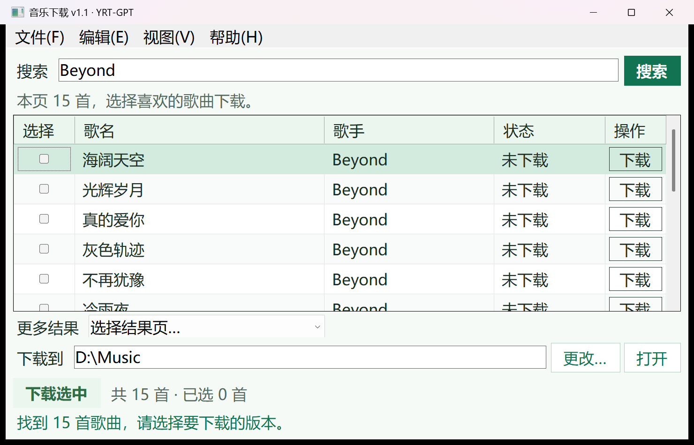

<div align="center">
  
  <h1>YRT Music</h1>
  <p>Search first. Choose your songs. Save preview MP3s.</p>
  <p><strong>English</strong> · <a href="README.zh-CN.md">简体中文</a></p>
  <p>
    
    
    <a href="LICENSE"></a>
  </p>
  <p><a href="#download">Download</a> · <a href="#features">Features</a> · <a href="#usage">Usage</a> · <a href="CHANGELOG.md">Changelog</a> · <a href="#build-from-source">Build from source</a></p>
</div>


*Original brand illustration. The app's actual interface appears below.*

YRT Music is a Windows music downloader. Enter an artist, song title, or part of a title, review the results from Gequhai, and choose which preview MP3s to save. Searches and downloads use an independent Chrome session in the background.

## Download

**Official release date: 2026-11-04 (Asia/Shanghai).** Derived from this GitHub Release's actual `published_at`. See the [release policy](docs/ReleasePolicy.md).

| Platform | Download file | Use |
| --- | --- | --- |
| Windows 10 / 11, 64-bit | [YRTMusic-Setup-v1.1-x64.exe](https://github.com/yrt-coder/YRTMusic/releases/download/v1.1/YRTMusic-Setup-v1.1-x64.exe) | Install for the current Windows user and choose the installation folder. Installer languages: Simplified Chinese, Traditional Chinese, and English. |
| Windows 10 / 11, 64-bit | [YRTMusic-v1.1.zip](https://github.com/yrt-coder/YRTMusic/releases/download/v1.1/YRTMusic-v1.1.zip) | Extract the complete folder and run without an installer. Complete application source is included. |

Both packages require **.NET Framework 4.8** and an installed **Google Chrome**. The application interface is in Chinese. The installer languages do not change the application's language.

Download from [GitHub Releases](https://github.com/yrt-coder/YRTMusic/releases/tag/v1.1). The portable ZIP is also available in the repository root. The earlier [v1.0 release](https://github.com/yrt-coder/YRTMusic/releases/tag/v1.0) remains available.

For the portable package, extract every file before opening `YRT-GPT_MusicDownloader.exe`. Keep the accompanying files with the program.

## Features

- Search by artist, song title, or part of a title, then review the site's returned results. Searching does not start downloads.
- Download one result, or select multiple songs and download the selection.
- Browse the result pages supplied by the site.
- Choose a download folder; the app remembers it for the next launch.
- Use Chrome in the background for normal searches and downloads. Open the app's separate browser when a page requires manual attention.
- Choose 12, 14, or 16 pt text; the default is 14 pt.
- Cancel an operation, view download records, and locate saved files.

<p align="center">
  
</p>

*Actual Windows screenshot from this v1.1 release, showing the results of one live Beyond search. The interface uses Chinese labels.*

## Usage

1. Open `YRT-GPT_MusicDownloader.exe` from the installed or extracted folder.
2. Enter an artist or part of a song title, then click **Search** (`搜索`) or press Enter.
3. Review the song and artist names. Click **Download** (`下载`) on one row, or select several results and click **Download selected** (`下载选中`).
4. Use **Change** (`更改…`) beside the download folder to choose where files are saved. Click **Open** (`打开`) to view that folder.
5. If the site provides more result pages, use the page controls below the list.

Chrome normally stays in the background. If the page asks for manual verification, use **Help → Handle in browser** (`帮助 → 在浏览器处理`), complete the normal page steps, and search again. Use the **View** (`视图`) menu to switch Chrome back to the background or change the text size.

## Build from source

Application source and the Windows manifest are available directly in `src/`.

```powershell
git clone https://github.com/yrt-coder/YRTMusic.git
cd YRTMusic
.\build.ps1 -OutputDirectory .\Build
```

Build on Windows with the .NET Framework C# compiler. The build produces `Build/YRT-GPT_MusicDownloader.exe`; no NuGet packages or additional .NET SDK are needed. Building and release signing are separate steps. Preserve the release metadata and accompanying files when preparing a complete package.

The public version is **v1.1**, with application file version **1.1.0.0** and GitHub tag **v1.1**. The earlier **v1.0.0** release retains its original tag **v1.0** and official release date **2026-10-31**.

## Support

Report bugs or request features through [GitHub Issues](https://github.com/yrt-coder/YRTMusic/issues). Include the version, Windows version, and the error shown by the app. Remove account details and personal folder paths from screenshots before posting.

## License

Software: [MIT](LICENSE), copyright 2026 **YRT-GPT**.

The software license does not grant rights to music content.
