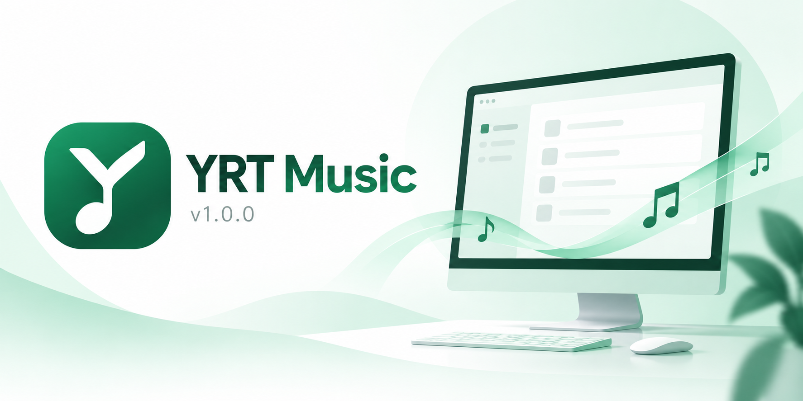
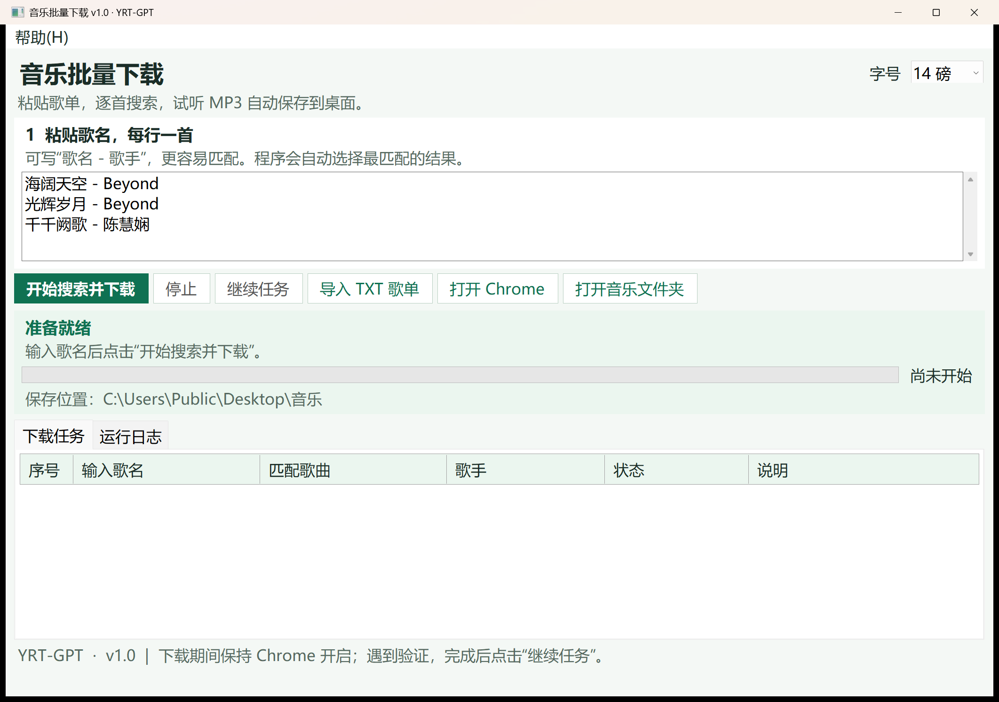

<div align="center">
  
  <h1>YRT Music</h1>
  <p>Search a song list. Save matching preview MP3s.</p>
  <p><strong>English</strong> · <a href="README.zh-CN.md">简体中文</a></p>
  <p>
    <a href="https://github.com/yrt-coder/YRTMusic/releases/tag/v1.0"></a>
    
    <a href="LICENSE"></a>
  </p>
  <p><a href="#download">Download</a> · <a href="#features">Features</a> · <a href="#usage">Usage</a> · <a href="CHANGELOG.md">Changelog</a> · <a href="#build-from-source">Build from source</a></p>
</div>



*Original brand illustration. The Windows app screenshot appears below.*

YRT Music is a batch music downloader for Windows. Enter one song title per line. It searches Gequhai in Chrome, selects a matching result, and saves preview MP3 files to the `音乐` (Music) folder on your desktop.

## Download

**[Download YRTMusic-v1.0.zip](https://github.com/yrt-coder/YRTMusic/releases/download/v1.0/YRTMusic-v1.0.zip)**

**Official release date: 2026-10-31 (Asia/Shanghai).** See the [release policy](docs/ReleasePolicy.md) for date verification.

| Platform | Package | Requirements |
| --- | --- | --- |
| Windows 10 / 11, 64-bit | Portable ZIP with complete source | .NET Framework 4.8 and Google Chrome |

Extract the entire ZIP, then run `YRT-GPT_MusicBatch.exe`.

This page presents the historical release as **v1.0.0**. Its existing GitHub tag is **v1.0**; both labels refer to the same download. [All releases](https://github.com/yrt-coder/YRTMusic/releases).

## Features

- Paste a song list or import a TXT file, with one song per line.
- Search and automatically match each song through Chrome.
- Save preview MP3s to the desktop Music folder and view each task's result.
- Stop a batch, or resume after completing website verification in Chrome.
- Choose 12, 14, or 16 pt text; the default is 14 pt.

<p align="center">
  
</p>

*Actual Windows app screenshot. The interface uses Chinese button labels in this version.*

## Usage

1. Open `YRT-GPT_MusicBatch.exe` from the extracted folder.
2. Paste one song title per line, or import a TXT list. Adding an artist's name helps matching.
3. Click **Start Search and Download** (`开始搜索并下载`).
4. Check the task list, then click **Open Music Folder** (`打开音乐文件夹`) to view saved files.

A Chrome window opens during searches. Keep the app and Chrome open while downloading. If the site asks for verification, complete it in Chrome and click **Resume Task** (`继续任务`). Click **Stop** (`停止`) to end the batch.

## Build from source

Clone the repository and build from its main folder in PowerShell:

```powershell
git clone https://github.com/yrt-coder/YRTMusic.git
cd YRTMusic
.\build.ps1 -OutputDirectory .\Build
```

Application source and the Windows manifest are in `src/`. The script uses the Windows .NET Framework C# compiler and writes an unsigned executable to `Build/YRT-GPT_MusicBatch.exe`. No NuGet packages or additional SDK are needed.

Optional release helpers are in `tools/signing/`; they are separate from the application build. The download ZIP also retains its complete source in `Source`.

## Support

Report bugs or request features through [GitHub Issues](https://github.com/yrt-coder/YRTMusic/issues).

## License

Software: [MIT](LICENSE), copyright 2026 **YRT-GPT**.

Only download music you have permission to save. The software license does not grant rights to music content.
