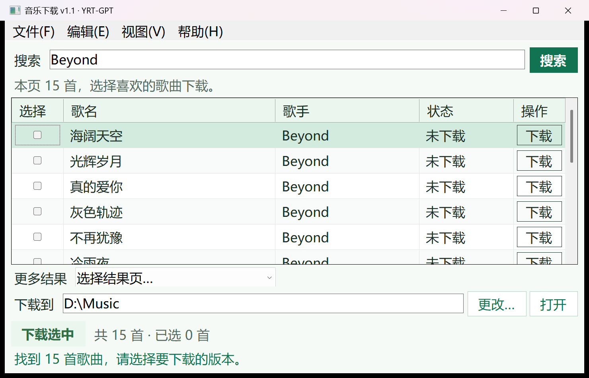

<div align="center">
  
  <h1>YRT Music</h1>
  <p>先搜索，再选歌，保存试听 MP3。</p>
  <p><a href="README.md">English</a> · <strong>简体中文</strong></p>
  <p>
    
    
    <a href="LICENSE"></a>
  </p>
  <p><a href="#下载">下载</a> · <a href="#功能">功能</a> · <a href="#使用方法">使用方法</a> · <a href="CHANGELOG.md">更新记录</a> · <a href="#从源码构建">从源码构建</a></p>
</div>


*原创品牌插画，真实程序界面见下方。*

YRT Music 是一个 Windows 音乐下载工具。输入歌手、歌名或部分关键词，查看歌曲海返回的结果，再自己选择要保存的试听 MP3。正常搜索和下载使用独立的后台 Chrome。

## 下载

**正式发布日期：2026-11-04（Asia/Shanghai）。** 日期取自本次 GitHub Release 的实际 `published_at`，规则见[发布规范](docs/ReleasePolicy.md)。

| 系统 | 下载文件 | 使用方式 |
| --- | --- | --- |
| Windows 10 / 11，64 位 | [YRTMusic-Setup-v1.1-x64.exe](https://github.com/yrt-coder/YRTMusic/releases/download/v1.1/YRTMusic-Setup-v1.1-x64.exe) | 为当前 Windows 用户安装，可自选安装目录；安装向导提供简体中文、繁体中文、English。 |
| Windows 10 / 11，64 位 | [YRTMusic-v1.1.zip](https://github.com/yrt-coder/YRTMusic/releases/download/v1.1/YRTMusic-v1.1.zip) | 完整解压后直接运行，附完整应用源码。 |

两种下载包均需要 **.NET Framework 4.8** 和已安装的 **Google Chrome**。**程序界面保持中文**，安装向导的三种语言不改变程序语言。

在 [GitHub Releases](https://github.com/yrt-coder/YRTMusic/releases/tag/v1.1) 下载；便携 ZIP 同时放在仓库首页文件列表。此前的 [v1.0 下载](https://github.com/yrt-coder/YRTMusic/releases/tag/v1.0)继续保留。

使用便携版时，请完整解压后运行 `YRT-GPT_MusicDownloader.exe`，保留程序旁的配套文件。

## 功能

- 按歌手、歌名或部分关键词搜索，先显示网站返回的结果，搜索不会自动下载。
- 点击某首歌曲的“下载”，或勾选多首后点击“下载选中”。
- 查看网站实际提供的结果分页。
- 自选下载目录，下次启动时保留。
- 正常搜索和下载使用后台 Chrome；需要人工处理网页时，可主动打开本程序独立的浏览器。
- 默认 14 磅字号，可切换为 12 或 16 磅。
- 取消当前操作、查看下载记录、定位已保存的文件。

<p align="center">
  
</p>

*从本次 v1.1 正式程序截取的真实 Windows 界面，显示一次 Beyond 实际搜索结果。程序使用中文标签。*

## 使用方法

1. 打开安装目录或解压目录中的 `YRT-GPT_MusicDownloader.exe`。
2. 输入歌手或歌名片段，点击“搜索”或按 Enter。
3. 查看结果中的歌名和歌手。点击某行的“下载”，或勾选多首后点击“下载选中”。
4. 在下载目录旁点击“更改…”选择保存位置，点击“打开”查看文件夹。
5. 网站提供多页结果时，使用列表下方的分页控件继续查看。

Chrome 默认在后台运行。遇到网页人工验证时，从“帮助 → 在浏览器处理”打开本程序独立的浏览器，正常处理后重新搜索。可在“视图”菜单切回后台运行，也可以调整字号。

## 从源码构建

应用源码和 Windows 清单位于仓库的 `src/`，可直接在线查看。

```powershell
git clone https://github.com/yrt-coder/YRTMusic.git
cd YRTMusic
.\build.ps1 -OutputDirectory .\Build
```

在 Windows 上使用 .NET Framework C# 编译器构建，生成 `Build/YRT-GPT_MusicDownloader.exe`，无需 NuGet 包或额外 .NET SDK。程序构建和发布签名分别进行；制作完整下载包时，应保留发布信息及配套文件。

本次公开版本为 **v1.1**，程序文件版本为 **1.1.0.0**，GitHub 标签为 **v1.1**。此前 **v1.0.0** 保留原标签 **v1.0**，正式发布日期仍是 **2026-10-31**。

## 支持

通过 [GitHub Issues](https://github.com/yrt-coder/YRTMusic/issues)反馈问题或提出建议。反馈时可附上程序版本、Windows 版本和错误提示；公开截图前请遮住账户信息与个人目录。

## 许可证

软件采用 [MIT 许可证](LICENSE)，版权归 2026 **YRT-GPT**。

音乐内容的权利不随软件许可证授予。
